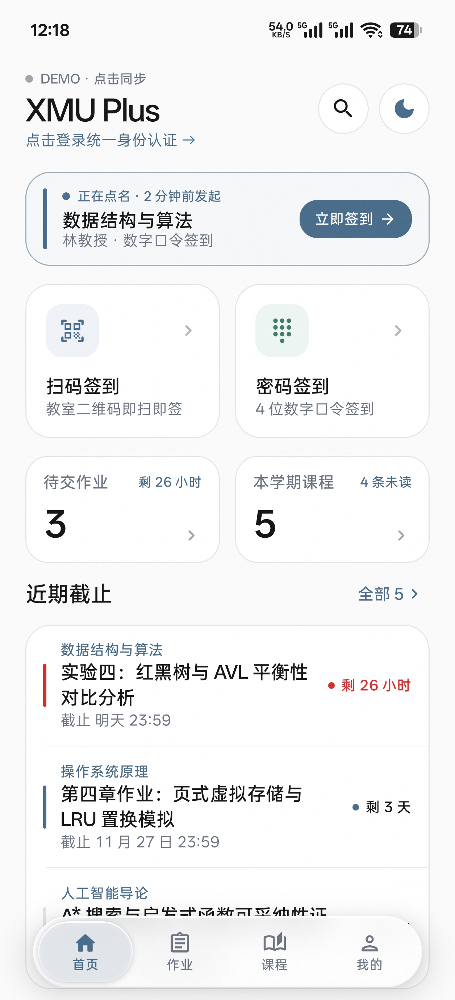
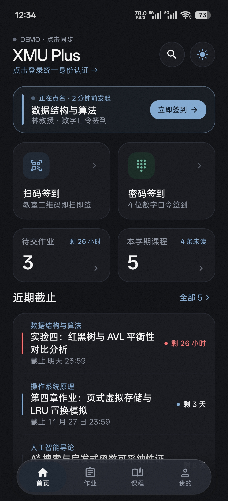
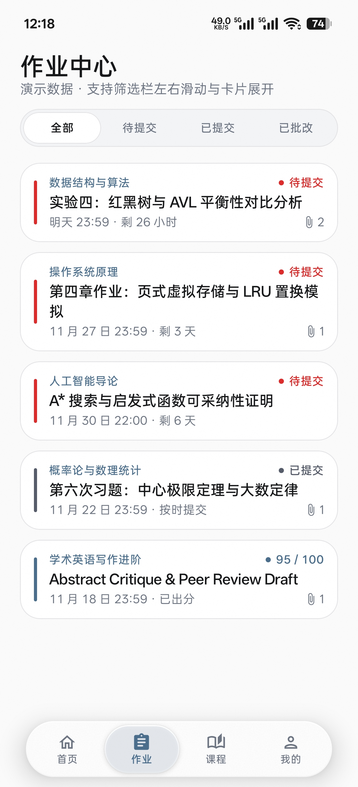
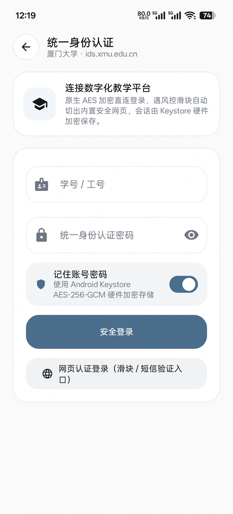
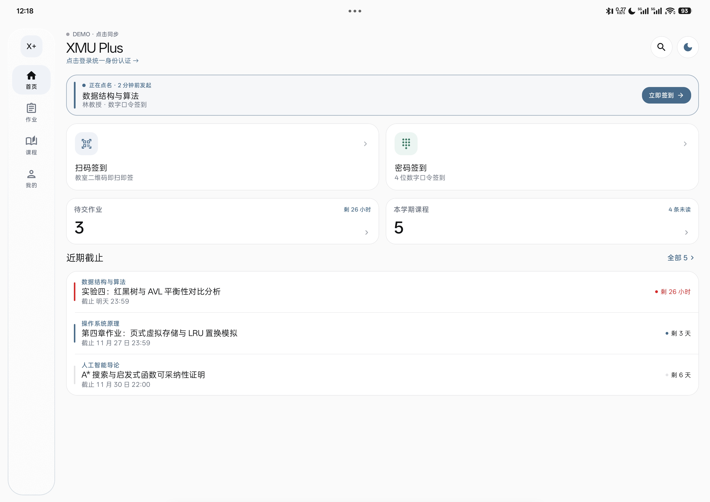
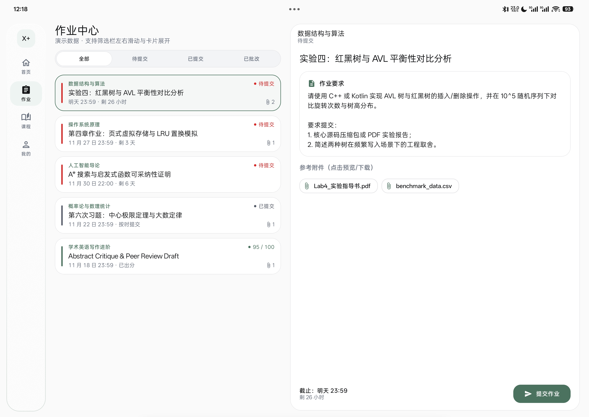

<div align="center">

# XMU Plus · 厦大课堂小助手

为厦门大学数字化教学平台（畅课 TronClass）打造的原生 Android 第三方客户端  
采用纸白 / 曜石黑极简精密线框与瑞士排版美学，支持校外直连、极速课堂签到、作业提交与桌面 DDL 倒计时

[](LICENSE)
[](#技术栈)
[](#技术栈)
[](#技术栈)

[功能特性](#核心功能) • [界面预览](#界面预览) • [项目结构](#项目结构) • [本地构建](#本地构建与发布说明) • [开源许可](#开源与致谢)

</div>

---

## 项目简介

**XMU Plus（厦大课堂小助手）** 基于 Kotlin 与 Jetpack Compose 原生构建，对接厦门大学数字化教学平台（`lnt.xmu.edu.cn` / `c-mobile.xmu.edu.cn`）与统一身份认证（`ids.xmu.edu.cn`），校外网络无需 VPN 即可使用。

> 觉得这个小助手帮到了你的日常学习与签到？欢迎在右上角点一个 **Star** 支持一下！

---

## 核心功能

- **极简精密线框与双主题设计**
  - 纯净纸白（`#FAFAFA`）/ 深曜石黑（`#0C0D10`）双主题，`0.6dp` 极细边框（Hairline Border）配合等宽数字（`tnum`）排版与高阻尼无过冲动效。
  - 提供 **5 款克制莫兰迪点缀色**（雾霭灰蓝 / 鼠尾草 / 赤陶 / 暮紫灰 / 石墨），可选 **液态玻璃（Haze）/ 经典纯色 Dock** 与 **共享元素过渡开关**。
- **安全可靠的统一身份认证**
  - 支持厦门大学 CAS 原生 AES 加密直连登录，使用 **Android Keystore AES-256-GCM** 硬件加密本地保存账号凭证与会话。
  - 遇到风控滑块或短信验证时自动切出内置安全 WebView 完成验证并同步会话。
- **双入口快捷课堂签到与考勤查询**
  - **扫码签到**：集成 CameraX + ML Kit Barcode Scanning 实时识别课堂二维码（兼容畅课 JSON 与 `/j?p=` 跳转链接），支持双指捏合缩放、快捷倍率切换、点击对焦、手电筒、相册扫码与手动粘贴。
  - **密码签到**：4 位数字口令专属大键盘，支持错误震动与反馈提示；首页实时捕获正在进行的课堂点名。
  - **签到记录查询**：聚合各门课程的历史点名记录，统计出勤率与已签到 / 迟到请假 / 缺勤次数，支持按状态与课程筛选。
- **全流程作业中心与内置文档/图片浏览器**
  - 支持「全部 / 待提交 / 已提交 / 已批改」横向滑动与点击切换，统一卡片视觉风格与左侧窄状态竖线指示。
  - **轻量化内置图片与文档浏览器**：支持图片双指缩放原图查看、`PdfRenderer` 原生逐页 PDF/转换课件渲染、纯文本代码阅读，以及畅课在线预览与系统应用打开。
  - 查看作业要求、参考附件与提交记录，支持文档与相册图片多附件上传提交、修改重交，展示批改得分、评语与查重率。
- **课程空间与跨课程全局搜索**
  - 按学期切换查看课程作业、课件、公告与课程考勤；支持一键索引全部课程资源并跨课程检索课程、作业、课件与公告。
  - 内置离线 SQLite 缓存，无网或弱网环境下可快速浏览已缓存列表。
- **桌面小组件与 DDL 到期提醒**
  - **Jetpack Glance 桌面微件**：直接在手机桌面查看即将截止的待交作业与倒计时。
  - **WorkManager 后台提醒**：在截止前 24 小时 / 3 小时自动推送高优先级 DDL 通知（可选开关）。
- **大屏与系统适配**
  - 平板与横屏（屏幕宽度 ≥ `600dp`）自动切换左侧 `NavigationRail` + 双栏 Master-Detail 布局。
  - 全链路 Edge-to-Edge 沉浸式状态栏/导航栏、软键盘 `imePadding` 适配与 Android 15 预测性返回支持。

---

## 界面预览

### 手机端（浅色 / 深色双主题 & 认证 & 作业中心）

<table>
  <tr>
    <td align="center" width="25%">
      <br/>
      <sub><b>首页（浅色）</b> · 独立大卡扫码/密码签到</sub>
    </td>
    <td align="center" width="25%">
      <br/>
      <sub><b>首页（深色）</b> · 曜石黑精密线框</sub>
    </td>
    <td align="center" width="25%">
      <br/>
      <sub><b>作业中心</b> · 统一卡片与状态竖线</sub>
    </td>
    <td align="center" width="25%">
      <br/>
      <sub><b>统一身份认证</b> · AES 直连 + Keystore</sub>
    </td>
  </tr>
</table>

### 平板 / 宽屏双栏适配（≥ 600dp）

<table>
  <tr>
    <td align="center" width="50%">
      <br/>
      <sub><b>宽屏首页</b> · 左侧 NavigationRail 与双栏信息流</sub>
    </td>
    <td align="center" width="50%">
      <br/>
      <sub><b>宽屏作业详情</b> · Master-Detail 即点即看</sub>
    </td>
  </tr>
</table>

---

## 技术栈

| 领域 | 技术选型 |
| :--- | :--- |
| **语言与构建** | Kotlin `2.3.21` · AGP `8.13.2` · `compileSdk = 36` · `minSdk = 26` · JDK 17 |
| **UI 框架** | Jetpack Compose BOM `2026.05.01` · Material 3 `1.5.0-alpha16` · Navigation Compose · Haze `1.6.10` |
| **网络与解析** | OkHttp `4.12.0` · Kotlinx Serialization JSON `1.8.1` |
| **认证与安全** | Android Keystore（AES-256-GCM）· CAS AES CBC 加密登录 · In-App WebView 滑块兜底 |
| **扫码与相机** | CameraX `1.4.2` · ML Kit Barcode Scanning `17.3.0` |
| **桌面微件与后台** | Jetpack Glance `1.1.1` · WorkManager `2.10.0` · DataStore Preferences `1.2.1` |

---

## 项目结构

```text
app/src/main/java/cn/edu/xmu/plus/
├── MainActivity.kt                  # Edge-to-Edge 入口与状态绑定
├── auth/                            # CAS 登录、AES 加解密、Keystore 会话存储
├── data/                            # ViewModel、离线缓存、全局搜索引擎、二维码解析、主题偏好
├── network/                         # TronClass API 客户端与数据解析
├── reminder/                        # DDL 提醒通知与 WorkManager 定时评估
├── widget/                          # Jetpack Glance 桌面 DDL 倒计时微件
├── debug/                           # 脱敏调试日志存储（Logcat Tag: XmuPlusDebug）
└── ui/
    ├── XmuPlusApp.kt                # 根导航容器与自适应平板/手机外壳
    ├── theme/                       # 纸白/曜石黑双色板、字体排版与圆角规范
    ├── components/                  # NavigationDock / SegmentedControls / CheckInSheets / FrostedGlassUi
    └── screens/                     # Home / Homework / HomeworkDetail / Courses / RollcallHistory / InAppViewer / Profile / Settings / Search / QrScanner / Login
```

---

## 本地构建与发布说明

1. 克隆本仓库到本地：
   ```bash
   git clone https://github.com/3311625060a-bot/XMU-Plus.git
   ```
2. 使用 Android Studio 或命令行（JDK 17 + Android SDK Platform 36）构建：
   ```bash
   # 运行单元测试
   ./gradlew testDebugUnitTest

   # 构建 Debug APK（无混淆，适合日常二次开发与断点调试）
   ./gradlew assembleDebug

   # 构建 Release APK（默认开启 R8 混淆压缩与资源裁剪，体积更小、性能更佳）
   ./gradlew assembleRelease

   # 开发者如需构建未混淆的 Release 包用于对照排查，可附加参数：
   ./gradlew assembleRelease -PminifyRelease=false
   ```
3. **对开源社区与用户的友好保障**：
   - `proguard-rules.pro` 保留了 `SourceFile` 与 `LineNumberTable`，即使开启 R8 混淆，用户反馈的异常堆栈仍可定位文件与行号；每次正式 Release 亦会在 `app/build/outputs/mapping/release/mapping.txt` 产出映射表随版留档。
   - **安全与隐私承诺**：无任何第三方统计分析或闭源 SDK，账号密码及会话仅通过 **Android Keystore（AES-256-GCM）** 在本地硬件加密存储，网络请求仅直连厦门大学官方域名；如需自定义正式签名可在根目录放置 `signing.properties`（已被 `.gitignore` 忽略，不会随代码提交）。

---

## 开源与致谢

- **作者**：金将军的迈巴赫保养员
- **GitHub 仓库**：[https://github.com/3311625060a-bot/XMU-Plus](https://github.com/3311625060a-bot/XMU-Plus)
- **开源协议**：本项目基于 [MIT License](LICENSE) 开源，欢迎提 Issue、PR 与 **Star** 支持！

### 第三方开源软件许可（Open-Source Licenses）

本项目使用并感谢以下优秀的开源软件与 SDK：

| 项目名称 | 版本 | 维护方 / 作者 | 开源协议 | 用途说明 |
| :--- | :--- | :--- | :--- | :--- |
| [Kotlin & kotlinx.serialization](https://github.com/JetBrains/kotlin) | `2.3.21 / 1.8.1` | JetBrains s.r.o. | `Apache-2.0` | 编程语言与 JSON 序列化框架 |
| [AndroidX & Jetpack Compose](https://developer.android.com/jetpack) | `BOM 2026.05.01 / Material 3 1.5.0-alpha16` | The Android Open Source Project | `Apache-2.0` | Compose UI、Navigation、DataStore、Glance 微件、WorkManager 与 CameraX |
| [OkHttp](https://square.github.io/okhttp/) | `4.12.0` | Square, Inc. | `Apache-2.0` | HTTP/HTTPS 网络客户端与连接池 |
| [Haze](https://github.com/chrisbanes/haze) | `1.6.10` | Chris Banes | `Apache-2.0` | Compose 实时背景高斯模糊（液态玻璃底栏效果） |
| [ML Kit Barcode Scanning](https://developers.google.com/ml-kit/vision/barcode-scanning) | `17.3.0` | Google LLC | `Google APIs ToS` | 本地离线课堂签到二维码识别引擎 |
| [JUnit 4](https://junit.org/junit4/) | `4.13.2` | JUnit Team | `EPL-1.0` | 本地单元测试框架（仅用于测试） |

> 免责声明：本项目为个人开源学习与校园效率辅助工具，非厦门大学官方应用。请勿用于任何违规用途，使用过程中产生的账号及数据交互均在用户本地设备与学校官方服务器之间直接完成。
